## 👋 About me

Full-stack software engineer. I build features end to end, from backend and data layers to React frontends, and I care about tests, documentation, and clear explanations.

I'm currently contributing to open source and writing about what I learn along the way.

## 🛠 Tech stack

## 🌱 Open source contributions

<!-- Add a row only after the PR is actually opened/merged. Keep status honest: Open / Merged / Released. -->

| Project                                          | Contribution                                                                           | Status |
| ------------------------------------------------ | -------------------------------------------------------------------------------------- | ------ |
| [Recharts](https://github.com/recharts/recharts) | Fixed the stacked RadialBar domain so stack totals are included                        | Merged |
| [Mantine](https://github.com/mantinedev/mantine) | Made the Indicator "processing" pulse respect the reduced-motion accessibility setting | Merged |

## 🚀 Projects

- **[Memory Layer](https://github.com/roux-lon/memory-layer)**: local-first Electron + React tool for saving, summarizing, and searching articles.
- **[AI Agent Guard](https://github.com/roux-lon/breakpoint)**: backend safety layer that validates, blocks, redacts, or queues risky AI-agent actions before execution.

## ✍️ Writing

<!-- - [Article title](https://dev.to/your-link): one line on what it covers. -->

## 📫 Find me

